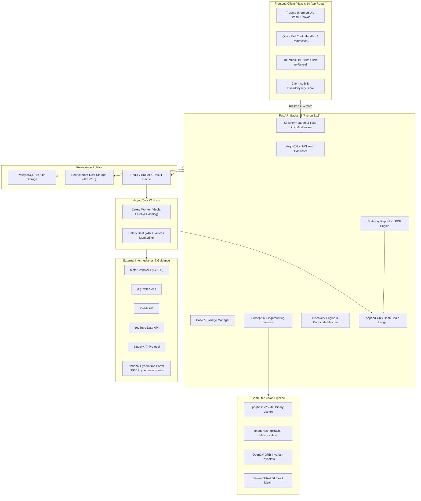

# SafeTrace Technical Architecture & Security Dossier

SafeTrace is a victim-centric digital safety platform designed for women and survivors of non-consensual image abuse (NCII, deepfakes, sextortion). It enables survivors to create secure cases, compute perceptual fingerprints without exposing original images, discover unauthorized public re-uploads across platforms, preserve tamper-evident cryptographic evidence, and automate formal statutory takedown reporting.

---

## 1. System Architecture



---

## 2. Multi-Method Image Matching Pipeline

Simple cryptographic hashes (such as MD5 or raw SHA-256) change completely if a single pixel is altered. Online perpetrators frequently crop, re-compress, add stickers, or alter brightness to evade simple hash filters. SafeTrace solves this through a multi-method composite pipeline:

| Algorithm | Vector Size | Primary Resistance | Weight | Threshold |
| :--- | :--- | :--- | :--- | :--- |
| **PDQ (pdqhash)** | 256 bits (64 hex characters) | JPEG compression, blur, brightness, contrast | 50% | Distance $\le 31$ |
| **Perceptual Hash (pHash)** | 64 bits (16 hex characters) | Discrete Cosine Transform (DCT) frequency shifts | 25% | Distance $\le 10$ |
| **Difference Hash (dHash)** | 64 bits (16 hex characters) | Gradient & edge structure changes | 10% | Distance $\le 10$ |
| **Average Hash (aHash)** | 64 bits (16 hex characters) | Low-frequency color luminance shifts | 5% | Distance $\le 10$ |
| **Multi-Scale Center Crop** | 64 bits (16 hex characters) | Perimeter cropping (15% border cuts) | Bonus | Distance $\le 8$ |
| **ORB Feature Matching** | 500 descriptors | Scale, rotation, and affine transformation | Bonus | Inliers $\ge 12$ |
| **Bitwise SHA-256** | 256 bits | 1:1 identical bit duplicates | 100% | Exact match |

### Similarity Score Calculation
$$\text{Score} = 100 \times \left( 0.50 \times \left(1 - \frac{D_{\text{PDQ}}}{256}\right) + 0.25 \times \left(1 - \frac{D_{\text{pHash}}}{64}\right) + 0.10 \times \left(1 - \frac{D_{\text{dHash}}}{64}\right) + 0.05 \times \left(1 - \frac{D_{\text{aHash}}}{64}\right) \right)$$

- **Confidence Bands**:
  - `HIGH`: Score $\ge 80.0\%$ (or exact SHA-256 match)
  - `MEDIUM`: Score $60.0\% - 79.9\%$
  - `LOW`: Score $40.0\% - 59.9\%$
  - `NONE`: Score $< 40.0\%$

---

## 3. Tamper-Evident Cryptographic Hash Chain

To satisfy the stringent electronic record admissibility requirements of **Section 65B of the Indian Evidence Act 1872** (now Bharatiya Sakshya Adhiniyam), SafeTrace organizes confirmed evidence into an immutable, append-only block chain:

1. **Genesis Block**: Initiates with parent hash `"GENESIS"`.
2. **Canonical JSON Serialization**: Sorts keys deterministically and strips whitespace.
3. **Payload Structure**:
   ```json
   {
     "evidence_number": "EV-2026-0001",
     "case_id": "8f83b165-...",
     "match_id": "4b27a312-...",
     "platform": "REDDIT",
     "source_url": "https://reddit.com/r/.../xyz",
     "captured_at": "2026-11-21T18:30:00.000000Z",
     "content_sha256": "dd15e2ba...",
     "similarity_score": 96.5,
     "previous_evidence_hash": "GENESIS"
   }
   ```
4. **Block Digest**:
   $$\text{Block Hash} = \text{SHA-256}(\text{Canonical Payload})$$
5. **Continuous Verification**: `verify_evidence_chain()` walks the linked list to ensure every block's parent pointer matches the previous block's digest. Any modification to a URL, timestamp, or score immediately breaks downstream hashes.

---

## 4. Statutory Takedown Legal Framework (Indian Law)

SafeTrace automatically formats grievance notices and ReportLab PDF dossiers to invoke specific provisions of Indian law:

1. **Information Technology (Intermediary Guidelines and Digital Media Ethics Code) Rules, 2021 — Rule 3(2)(b)**:
   - Mandates that any social media intermediary (Meta, X, Reddit, YouTube) **must acknowledge grievances within 24 hours** and **remove or disable access to non-consensual sexually explicit or morphed content within 24 hours** of receiving notification from the aggrieved individual.
2. **Information Technology Act, 2000 — Section 66E**:
   - Criminalizes intentionally capturing, publishing, or transmitting images of private areas of any person without consent (imprisonment up to 3 years or fine up to ₹2 Lakh).
3. **Information Technology Act, 2000 — Section 67 & 67A**:
   - Criminalizes publishing or transmitting obscene or sexually explicit material electronically (imprisonment up to 5 years and fine up to ₹10 Lakh).
4. **Bharatiya Nyaya Sanhita, 2023 — Sections 354C & 354D**:
   - Codifies the offenses of voyeurism and cyberstalking against women, establishing non-bailable penalties on repeated offenses.

---

## 5. Privacy, Ethics & Zero-Knowledge Architecture

1. **Zero-Knowledge Fingerprinting**: By default, raw source images are uploaded to memory, analyzed to generate perceptual vectors, and immediately purged from the server.
2. **Pseudonymity**: Victims can register without submitting their real name, phone number, or government identity.
3. **Trauma-Informed Default Blurring**: Discovered thumbnails are masked by default with a `blur-2xl` CSS filter. The victim or advocate must explicitly click to unmask.
4. **Emergency Quick Exit**: A persistent button (and `Escape` key shortcut) instantly purges local session tokens and replaces the active browser window with a neutral weather forecast.
5. **Right to be Forgotten**: One-click complete erasure purges all cases, hashes, logs, and account records irreversibly.
